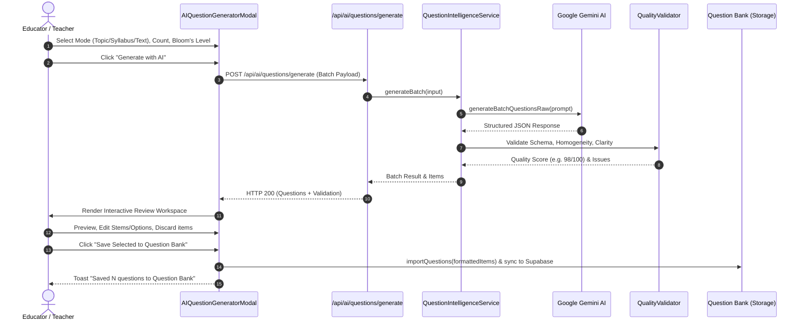

# QUIZDORM — PHASE 2.0 AI QUESTION GENERATOR SPECIFICATION

**Feature Name:** QuizDorm Intelligent Question Generator Studio (Phase 2.0)  
**Target Users:** Teachers, Course Authors, Academic Master Admins, Quiz Creators  
**Component Location:** [`components/ai/AIQuestionGeneratorModal.tsx`](file:///f:/quizdorm/components/ai/AIQuestionGeneratorModal.tsx)  
**Backend Route:** [`app/api/ai/questions/generate/route.ts`](file:///f:/quizdorm/app/api/ai/questions/generate/route.ts)

---

## 1. Feature Overview

The Phase 2.0 AI Question Generator empowers educators to rapidly author curriculum-aligned assessment questions using Google Gemini AI. Rather than generating ungrounded trivia, it enforces strict pedagogical standards:
- **Bloom's Revised Taxonomy Alignment** (Remember, Understand, Apply, Analyze, Evaluate, Create).
- **Categorical Distractor Homogeneity** (all options belong to the exact same grammatical and conceptual category).
- **Educational Rationales & Misconceptions** (every distractor includes an explanation and specific misconception tag).
- **Authoritative Human-in-the-Loop Curation** (educators preview, edit, discard, and selectively save items).

---

## 2. Four Operational Generation Modes

| Mode | Input Parameters | Grounding Behavior |
| :--- | :--- | :--- |
| **1. Topic / Domain** | Subject, Topic, Subtopic, Target Objective | Grounds questions in established academic curriculum principles for the discipline. |
| **2. Syllabus / Units** | Syllabus Text Outline, Unit Topics | Distributes items evenly across the curriculum units specified by the educator. |
| **3. Pasted Text** | Article, Reading Excerpt, Textbook passage | **Strict Grounding**: Every question, correct answer, and distractor is derived exclusively from the text. |
| **4. Document Upload** | PDF, TXT, Markdown, Image (up to 50MB) | Extracts text server-side and synthesizes questions directly from document concepts. |

---

## 3. Supported Question Types

The generator strictly outputs question formats supported by QuizDorm's authoritative scoring engine:
1. `mcq_single`: 4 homogeneous options, exactly 1 marked `isCorrect: true`.
2. `mcq_multiple`: 4–5 homogeneous options, 2 or more marked `isCorrect: true`.
3. `true_false`: Binary evaluation with pedagogical justification.
4. `fill_in_the_blank`: Question stem with `[blank]` placeholder and accepted keyword list in `fillBlanks`.
5. `match_following`: 3–4 paired concept relationships with unambiguous matches.
6. `sequence_ordering`: 3–5 chronological or procedural steps with numerical ordering.

---

## 4. End-to-End Workflow

---

## 5. Security & Safety Controls

1. **Server-Side API Key Sealing**: `GEMINI_API_KEY` is strictly held on the server and guarded by `assertServerContext()`. It is never transmitted to the browser.
2. **Sliding Window Rate Limiter**: Configured with 25 requests/min per IP to prevent quota exhaustion and API abuse.
3. **Graceful Fallback**: If Gemini encounters temporary capacity spikes (HTTP 503), the engine automatically falls back to `gemini-flash-lite-latest` or the local [`DocumentFallbackSynthesizer`](file:///f:/quizdorm/lib/ai/server/documentFallbackSynthesizer.ts) to guarantee zero UI downtime.
4. **Untrusted Input Sanitization**: Uploaded text and syllabus outlines are sanitized before prompting, and model outputs are parsed through Zod runtime validation schemas.
